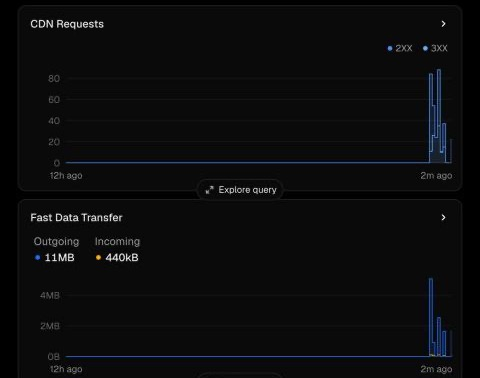
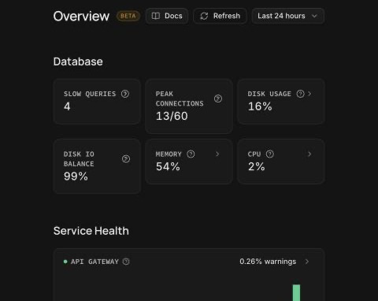

# Cogsplint

## Project overview

Cogsplint is a self-help app for phone and web. This first milestone, **Daily Discipline**, helps you keep daily
habits in a gentle way: you plan your tasks, check them off to earn points, spend the points on rewards for yourself,
and see how you are doing over time. The wording never blames you for a missed day.

Live web app: https://cogsplint.vercel.app

## Features

- **Account:** sign up, log in and log out with email and password. Each user can only see their own data.
- **Today:** today's tasks grouped by Morning, Afternoon, Evening and Anytime, with one-tap check-off and undo,
  and a progress ring.
- **Manage:** add, edit and delete tasks, each with points and a time of day. Past check-ins stay in your history
  after a task is edited or deleted.
- **Rewards:**
  - Points balance, what it is worth in dollars, and an exchange rate you can change.
  - "Treat yourself": spend points on a reward, with an optional photo and a short note.
  - A line chart of the points earned each month.
  - Reward history by month, with a month picker for older months and full-screen photos.
  - An undo that would make your balance negative is blocked, with an explanation.
- **Analysis:** current streak, 30-day completion rate, perfect days, a 12-week heatmap (tap a day to see its tasks),
  and the results for each task.
- **Phone and web:** one codebase for the iPhone (Expo Go) and the browser.
- A second section, "CBT / Mind", currently shows "Coming soon".

## Usage

1. Open the live link and choose **Create an account** (any email, password of at least 6 characters).
2. In **Manage**, add the tasks you want to do each day.
3. In **Today**, tap a task to check it off. Tap it again to undo.
4. In **Rewards**, choose **Treat yourself** to spend points on a reward.
5. In **Analysis**, see your streak and progress. Tap a square in the heatmap to see that day.

## Technologies used

| Area | Technology | Used for |
|---|---|---|
| Language | TypeScript | Type checking for the whole app |
| App framework | React 19, React Native, Expo SDK 58 | One codebase for phone and web |
| Navigation | Expo Router | File-based routes, tabs, slide-up screens, logged-in / logged-out guard |
| Server data | TanStack Query | Loading, caching and refreshing data, optimistic check-off |
| Backend | Supabase | Auth, Postgres database with row level security, private photo storage |
| Graphics and photos | react-native-svg, expo-image, expo-image-picker | Progress ring, chart, photo upload and display |
| Web | react-native-web, Vercel | Browser version and hosting |
| Testing and CI | Jest (jest-expo), GitHub Actions | Unit tests and type check on every pull request |

## Installation

You need Node.js 22, a free [Supabase](https://supabase.com) project, and (for the phone) the Expo Go app.

1. Clone the repository and install the packages: `npm install`
2. Set up the database: in the Supabase dashboard, open **SQL Editor**, paste the whole file
   `supabase/migrations/20261110120000_m1_tables.sql`, and run it once. It creates the tables, the security rules
   and the private photo bucket.
3. In **Authentication > Sign In / Providers**, turn **Confirm email** off for local testing, or confirm each new
   account by email.
4. Copy `.env.example` to `.env` and fill in your project URL and publishable (anon) key.
   Never use the service_role / secret key in the app.
5. Start the app: `npx expo start`. Scan the QR code with the iPhone camera to open it in Expo Go,
   or press `w` to open it in the browser.

## Architecture

```
Screens (*-screen.tsx and components/)
   |  show data and react to taps
   |------> Pure logic (*-logic.ts): calculations such as balance, streak, heatmap. Unit tested.
   v
Data hooks (*-api.ts): TanStack Query
   v
Supabase: Auth, Postgres (row level security), Storage
```

- **Separation of concerns:** routes in `app/` are thin; each feature keeps its screens, data hooks and calculations
  in separate files.
- **Data flow:** screens read through query hooks. After a change (such as a check-off), the hook marks the related
  data as outdated so every tab refreshes. Check-off updates the screen immediately and rolls back if saving fails.
- **State management:** server data lives in TanStack Query; the logged-in user is shared with React Context
  (`auth-context.tsx`); form and view state stays inside each screen with React hooks; the app's popup uses a small
  store read with `useSyncExternalStore`.
- **No custom server:** the app talks to Supabase directly. The data operations are documented in `docs/api/`.
- **Calculated, not stored:** the points balance is always earned points minus spent points, so it cannot get out of
  step with the history. A database trigger saves a copy of each task at check-in, so editing a task never changes
  the past.
- **Security:** every table has row level security (`user_id = auth.uid()`), photos are in a private bucket and shown
  with temporary links, and only the public key is used in the app.

## Web version

Live link: https://cogsplint.vercel.app

The web version is hosted on Vercel and uses the same Supabase project as the phone app. Settings are in `vercel.json`.

- **Redeploy:** merge into `main`. Vercel builds and publishes it automatically.
- **Environment variables** (Vercel > Project > Settings > Environment Variables): `EXPO_PUBLIC_SUPABASE_URL` and
  `EXPO_PUBLIC_SUPABASE_ANON_KEY`, the same two as in `.env`. Never add the service_role (secret) key.
  After changing them, redeploy, because the values are baked in when the app is built.
- **Supabase** (Authentication > URL Configuration): "Site URL" and "Redirect URLs" must include the live link.
- **Try a build locally:** `npx expo export --platform web` writes the site to `dist/`.
- **Popups:** use `showDialog` from `src/lib/dialog.ts` (the app's own popup, same on phone and web), not
  `Alert.alert`, which does nothing in a browser. A new screen that slides up over the app needs its own
  `<DialogHost level={1} />`.

## Security, monitoring and scalability

### Security
- **Row level security** on every table: each user can read and change only their own rows. `supabase/tests/rls_check.sql`
  checks this with two accounts.
- **Photos** are in a private storage bucket, in a folder per user, and shown through links that expire after one hour.
- **Keys:** the app and website contain only the public (publishable) key. `.env` is not committed. The JavaScript of
  the live site was searched after the first deploy and had no secret key.
- **History:** a database trigger fills in the points of each check-in, so the app does not choose them.
- **Known gaps:** email confirmation is off to keep sign-up simple for this milestone, and the rule that the points
  balance cannot go below zero is checked in the app, not in the database.

### Monitoring
The app uses the dashboards that come with the two services. These are the places to check after a deploy.

| Where | What it shows |
|---|---|
| Vercel > project > Deployments | Whether each build succeeded, with build logs |
| Vercel > project > Observability | Requests to the website by status code, and data transferred |
| Supabase > Observability | Database health (slow queries, connections, disk, memory, CPU) and warnings for the API, Auth and Storage |
| Supabase > Logs | Individual requests and errors |

Limits: there are no automatic alerts, the free plans keep only a short history, and errors that happen inside a
user's browser or phone are not collected yet.

Screenshots from November 24, 2026:

| Vercel Observability | Supabase Observability |
|---|---|
|  |  |

### Scalability
- The website is static files served by Vercel's network, and there is no custom server to run or scale.
- Data, sign-in and photos are handled by Supabase, which can be moved to a larger plan as usage grows.
- Photos are compressed before upload.
- **Next limits to fix:** the reward history, the monthly chart and Analysis load a user's records in one request.
  Supabase caps how many rows one request returns, so long histories will need paging or totals calculated in the
  database.

## Folder structure

```
src/
├── app/            Screens' entry files. Every file here is a page. Keep them thin.
│   ├── _layout.tsx       Root frame: providers + login guard (logged out -> sign-in only)
│   ├── task-form.tsx     Add / edit task form (slides up over the tabs)
│   ├── reward-form.tsx   Treat yourself form (slides up over the tabs)
│   ├── (auth)/           The app before login (logged out users only see this)
│   │   ├── _layout.tsx       Frame for the logged-out pages
│   │   └── index.tsx         Default page: login / sign-up (thin: real screen in features/auth)
│   └── (main)/           The app after login. "(main)" is only a group name, not in the URL
│       ├── _layout.tsx       Top bar (Discipline / Mind) + the current page
│       ├── index.tsx         Default page: redirects to Daily Discipline
│       ├── mind/             CBT / Mind section
│       │   └── index.tsx         Its default page ("Coming soon")
│       └── discipline/       Daily Discipline section
│           ├── _layout.tsx       The 4 bottom tabs
│           ├── index.tsx         Tab 1: Today (default page of this folder)
│           └── manage.tsx, jar.tsx, analysis.tsx   Tabs 2-4
├── features/       The real code of each feature (screens, data hooks)
│   ├── auth/
│   │   ├── auth-context.tsx   Who is logged in (sign up, log in, log out)
│   │   └── sign-in-screen.tsx The login / sign-up screen
│   └── discipline/
│       ├── shared/       Used by several tabs (task list data, time blocks, date helper)
│       ├── jar/          Used only by the Rewards tab (named "jar" in code)
│       │   ├── jar-screen.tsx     The page (balance, Treat yourself, history)
│       │   ├── reward-form-screen.tsx  The Treat yourself form
│       │   ├── jar-api.ts         Talks to Supabase (balance, exchange rate, rewards)
│       │   ├── jar-logic.ts       Pure calculations (balance, money, validation)
│       │   ├── components/        Pieces the page uses (balance card, points chart, reward history, month picker, reward card, photo viewer)
│       │   └── tests/             Automated tests for the logic
│       ├── analysis/     Used only by the Analysis tab
│       │   ├── analysis-screen.tsx  The page (streak, heatmap, per-task stats)
│       │   ├── analysis-api.ts      Talks to Supabase (tasks and check-ins)
│       │   ├── analysis-logic.ts    Pure calculations (streak, completion rate, heatmap shades)
│       │   ├── components/          Pieces the page uses (stat cards, heatmap, day detail, task stats)
│       │   └── tests/               Automated tests for the logic
│       ├── today/        Used only by the Today tab
│       │   ├── today-screen.tsx   The page
│       │   ├── today-api.ts       Check-ins: list today's, check off, undo
│       │   ├── today-logic.ts     Pure calculations (date, time block, grouping)
│       │   ├── tests/             Automated tests for the logic
│       │   └── components/        Pieces the page uses (progress ring)
│       └── manage/       Used only by the Manage tab (screen, task form, save/delete)
├── components/     Small UI pieces used across the whole app (top bar, placeholder, popup, phone-width frame for the web)
├── lib/            App-wide setup (Supabase client, popup logic)
└── theme.ts        Colors, fonts, corner radius

supabase/           Database migrations, the RLS test, and test data for Rewards and Analysis (tests/)
.github/workflows/ CI: runs the type check and tests on every pull request
docs/api/           Data operations (Supabase calls), grouped by product
```

Rules of thumb:
- Inside a feature folder: `*-screen.tsx` is a page; pieces it uses go in a `components/` subfolder.
- A file in `app/` is a page. `_layout.tsx` is the frame around the pages in its folder.
  `index.tsx` is the default page of its folder.
- Used by one tab -> inside that tab's folder in `features/`.
  Used by several tabs -> `features/discipline/shared`.
  Used by the whole app -> `lib/` or `components/`.
- `*-logic.ts` is a pure calculation (no Supabase, no screens). Its tests live in a `tests/` subfolder
  of the same feature, named `<file>.test.ts`. Only create `tests/` when there is something to test.

## Tests

- `npm test` runs the automated tests. `npm run typecheck` runs the TypeScript check.
- Both also run automatically on every pull request (GitHub Actions), not on a timer.
- Database rules (RLS): run `supabase/tests/rls_check.sql` by hand after changing the database.

## Future improvements

- A profile page, with Log out moved there from Today.
- A choice of currency instead of dollars only.
- Proper tab icons.
- Screen and end-to-end tests, in addition to the logic tests.
- Error tracking inside the app, and automatic alerts for the live service.
- Email confirmation with our own email sender before a wider launch.
- Loading long histories in pages (Analysis currently reads only the most recent check-ins).
- Release on the Apple App Store, including account deletion.
