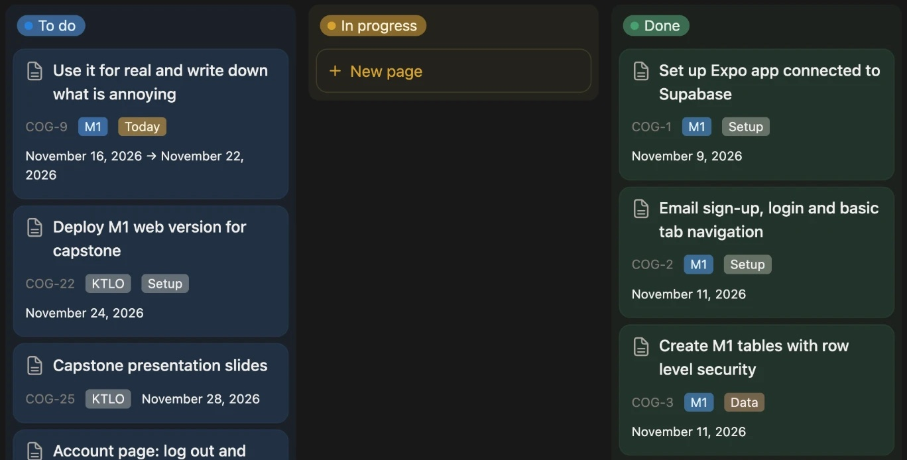
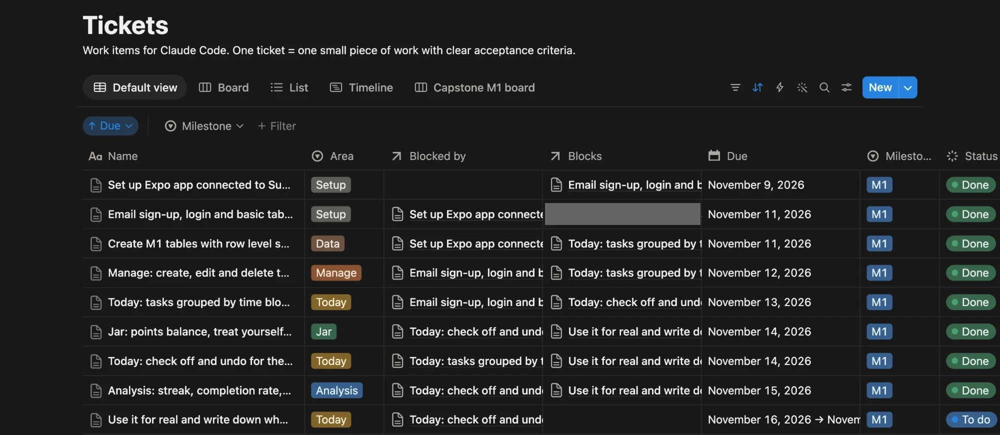
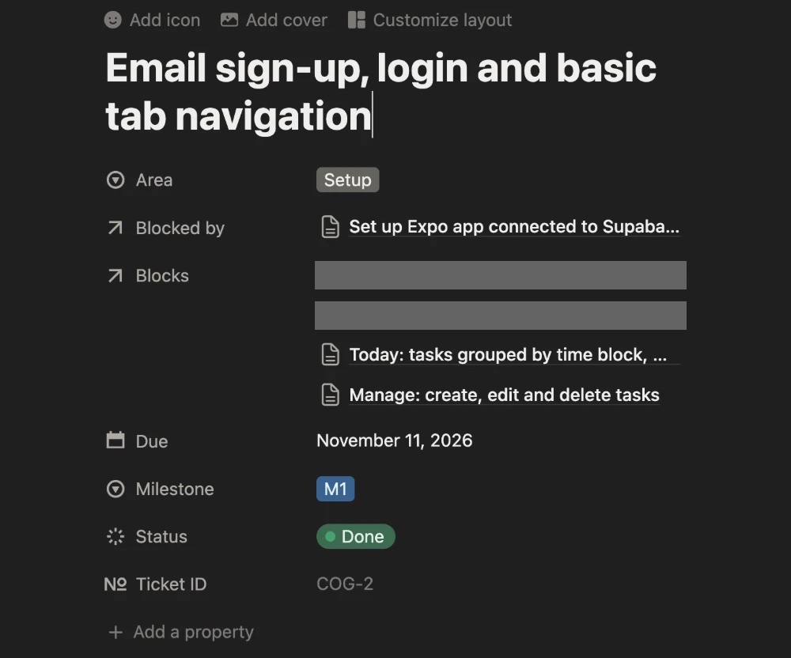
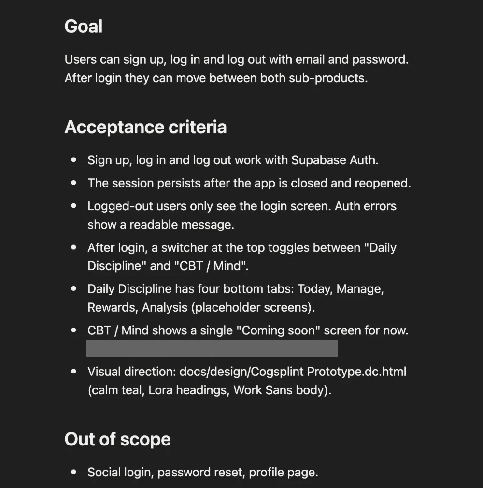
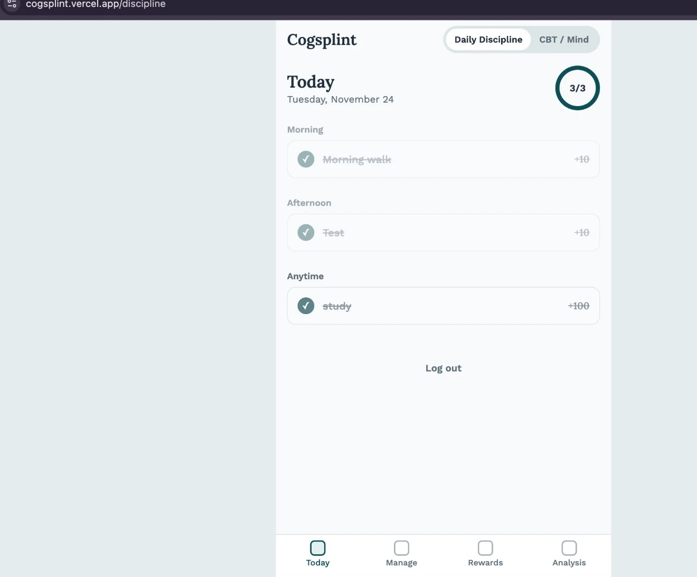
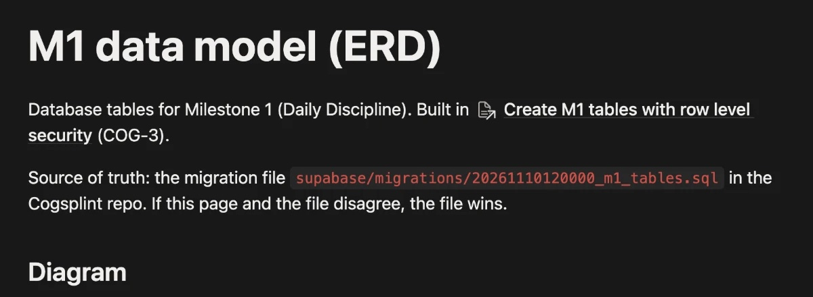
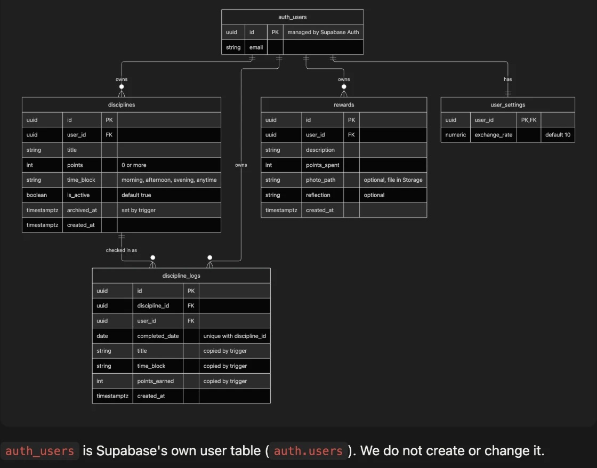
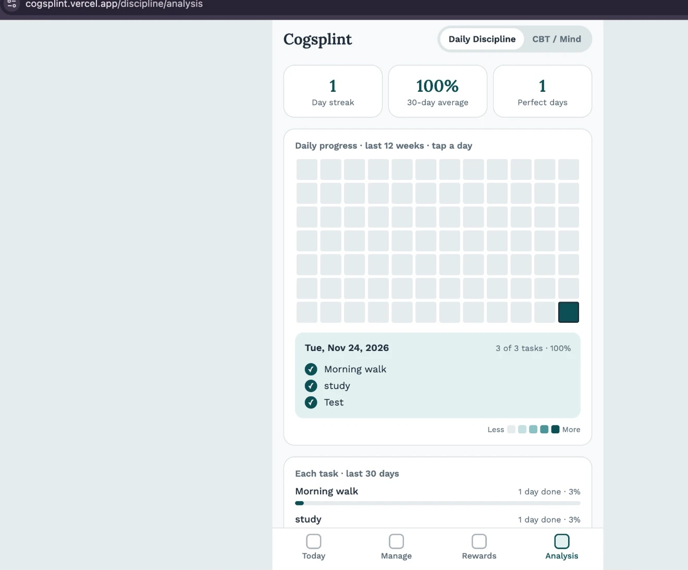

# Cogsplint devlog: Milestone 1, Daily Discipline

Live app: https://cogsplint.vercel.app

## How I worked

I worked in small tickets, one at a time. I acted as product manager: I chose the behaviour and wording, tested each
change on my iPhone (and later in the browser), and decided when to merge. I built it with an AI coding assistant
(Claude Code), which wrote code and helped find the causes of bugs. Each change went through a pull request, and from
the second half of Week 1 an automated type check and tests ran on every pull request.

Before and during development I also used Claude in a separate chat as a planning partner. It helped me turn my ideas
into a design document, a project proposal, milestones and tickets, and looked up facts when I asked. The ideas and the
product decisions were mine. The AI also helped me draft this devlog, including the reflections, from the project
records. I reviewed it and changed what did not match my experience.

I could focus on what the app should do and how it should feel, but it did not remove my part of the work. Many
problems only showed up when I tried the app myself: confusing wording, a history list that felt awkward, and popups
that looked like error messages. Reviewing and testing every change mattered as much as writing the code.

---

## Before development: idea and design (summer 2026 to November 9)

The first commit is from November 9, but the project started months earlier. I spent that time on the idea, the design
and the plan, so that development could move fast once it began.

### The idea
- By early August 2026 I was already planning Cogsplint.
- Cogsplint is a calm self-care app. The first module, Daily Discipline, helps people build small daily routines and
  reward themselves for keeping them, without the guilt and pressure that many productivity apps create.
- The people I had in mind are those who find it hard to look after themselves day to day, including neurodivergent
  people.
- The full product has a second module. It is not part of this capstone.

### Design and product work
- **Product design document (before development):** the structure of the app, the four Daily Discipline tabs (see the
  excerpt below), grouping tasks by time of day (morning, afternoon, evening, anytime), the data model, and a
  development plan in phases.
- **Research (October 2026):** I put together a reading list on habit building and product design.
- **Interactive prototype (before November):** I designed the screens in Claude Design and chose the visual direction:
  Lora for headings, Work Sans for body text, a calm deep teal, rounded shapes, and no red or warning colours.
- **Project proposal:** one page covering the idea, the features, the target audience and the tech stack (React Native
  with Expo, and Supabase).
- **Notion workspace:** organised into Product, Tech, and Ideas and research.
- **November 9, before the first commit:** milestones, a Tickets database with a board view and a list view, and
  "Blocked by" links between tickets. I also wrote a starting brief for Claude Code that pointed to the prototype as the
  visual reference.



*The ticket board in Notion on November 24, grouped by status. The Backlog column is cropped out.*



*The Milestone 1 tickets in Notion, taken on November 24, near the end of the milestone. One cell is hidden because it
names later work.*




*One ticket (COG-2). Lines about later work are hidden.*

### From the design document
I wrote the product design document in Chinese. This is a translated excerpt of the part about Daily Discipline. It
planned four tabs:

| Tab | What it does |
|---|---|
| Today | Daily task list and progress ring |
| Manage | Create and manage disciplines, and set their points |
| Points | Points balance, custom exchange rate, reward records with photos, and a chart of points growth |
| Analysis | Streak, completion rate, heatmap and per-task statistics |

The third tab was later called "Jar", and then renamed "Rewards".

### Key product decisions
1. **Milestones are defined by what changes for the user, not by technical layers.** Milestone 1 means "my daily routine
   lives in Cogsplint". Success: use it for a week, check off tasks every day, and spend points on a reward at least once.
2. **Milestone 1 is Daily Discipline only.** I build around a full-time job, with about an hour on weekday evenings plus
   weekends. Keeping the scope to one module made a one-week target realistic. The second module moved to later
   milestones.
3. **Notion as the ticket system.** I did not have Jira or Linear, so I used a Notion database. I tried a timeline view
   with dependency arrows, but it was hard to read. I switched to a list sorted by due date, with "Blocked by" links to
   show the order.
4. **Planning and building are separate.** Planning happened in the chat; the code was written in Claude Code from the
   tickets. I reviewed and tested every change and decided what to merge.

### Challenge: a scope misunderstanding in the first tickets
- **What happened:** the first set of tickets described Daily Discipline as the Today tab only. When the coding agent
  built from those tickets, it understood Milestone 1 the same way.
- **How I found it:** I reread the milestones and saw that Manage, Rewards and Analysis were missing.
- **Fix (November 10):** I rewrote the milestone page so it says what changes for the user, and added the missing tickets
  for Manage, Rewards and Analysis with their dependencies.

### What I learned
When an AI writes the code, the tickets are its picture of the product. My first tickets described Daily Discipline as
only the Today tab, so the coding agent understood Milestone 1 the same way. A milestone should say what changes for
the user, and each ticket needs a goal, acceptance criteria and what is out of scope. That makes it easier to build
one small thing at a time and to check that it is really done.

---

## Week 1: November 9 to 15

### Progress
- **Setup and accounts:** connected the Expo app to Supabase; email sign-up and login; main navigation.
- **Database:** created the tables with row level security, and wrote a SQL check that two users cannot see each
  other's data.
- **Manage and Today:** create, edit and delete tasks; today's tasks grouped by time of day; check off and undo.
- **Rewards:** points balance, exchange rate, "Treat yourself", reward history, photos, a points chart.
- **Quality:** reorganised the code into feature folders, added API docs, unit tests and CI (pull requests 1 to 12).



*The Today tab (screenshot of the web version, taken November 24).*

### Challenges and how we solved them

**1. The web version showed "Unmatched Route" after I moved the sign-in screen.**
- *Cause:* with Expo Router, a route group such as `(auth)` needs a default page. I had only `sign-in.tsx` inside it.
- *Fix:* renamed it to `(auth)/index.tsx`.

**2. I could not tell pages, components and data code apart.**
- *How it came up:* while reviewing, I could not see from the file names which files were screens.
- *Fix:* agreed naming rules: `*-screen.tsx` for pages, a `components/` folder for pieces, `*-api.ts` for talking to
  Supabase, `*-logic.ts` for calculations, and tests in `tests/`.

**3. Spending points and undoing a check-in could make the balance negative.**
- *How I found it:* testing on my phone, I spent points and then undid the check-in that had earned them.
- *Decision:* block the undo only when the balance would go below zero, explain why, and offer to open Rewards,
  where deleting a reward returns the points. I rewrote the message several times until it said clearly what would
  happen.

```ts
// A check-in can be undone only if the balance stays at 0 or more.
export function canUndoCheckIn(balance: number, pointsEarned: number): boolean {
  return balance - pointsEarned >= 0;
}
```

**4. Rewards were priced in points, which was not how I think.**
- *Insight:* users know what a reward costs in money, not in points.
- *Fix:* the form now asks for dollars and converts to points with the user's exchange rate.

### Milestone: the data model
Milestone 1 uses four tables of its own, each linked to Supabase's user table. Tasks (`disciplines`) are checked in as
rows in `discipline_logs`; `rewards` records what was spent, and `user_settings` holds the exchange rate. On
November 11, after the tables were created (COG-3), Claude Code documented them as an entity relationship diagram (ERD)
in Notion. The migration file in the repository is the source of truth.





*The data model page in Notion.*

### Milestone: history that never changes
The points balance is not stored. It is calculated from the history, and a database trigger copies each task at
check-in time. Editing or deleting a task later does not rewrite the past, and the app cannot send made-up points.

```sql
create trigger discipline_logs_copy_snapshot
  before insert on public.discipline_logs
  for each row execute function public.copy_discipline_snapshot();
```

### What I learned
A balance that is calculated from the history cannot drift away from it, while a stored number could. Row level
security means the database itself limits each user to their own rows, so the app is not the only thing protecting the
data. I also learned that clear folder and file names help me review code, even when I did not write it.

---

## Week 2: November 16 to 22

### Progress
- **Reward history by month** with a month picker, and a chart of points earned each month (pull request 13).
- **Analysis tab:** streak, completion rate, perfect days, heatmap and per-task results (pull request 14).



*The Analysis tab with a day selected (screenshot of the web version, November 24).*

### Challenges and how we solved them

**1. I could not test past months, because all my data was from November.**
- *Fix:* wrote SQL scripts that add clearly labelled test data for earlier months, plus a clean-up step
  (`supabase/tests/`).

**2. My first designs were not friendly enough.**
- *History:* the chart showed a running total, but I wanted to see how much I earned each month. A month chosen in the
  picker also stayed stuck at the bottom of the list. We changed it to show only that month, with a back link.
- *Long lists:* we considered folding rewards by week, which added taps for little benefit. We chose to show the
  newest 5 with "Show all".
- *Per-task results:* "1 of 8 days" under a "last 30 days" heading confused me. Every task now uses the same 30 days.
- *Heatmap:* inspired by GitHub, I asked for tapping a day to show what was done that day.

**3. A task added today should not lower last week's completion rate.**
- *Fix:* each day only counts the tasks that existed on that day. This is covered by unit tests.

### What I learned
A design that sounds right in a plan can feel wrong once I use it. I changed the chart, the month picker and the
wording of the task results only after trying them. Looking at it as a user helped me say what was wrong, and choosing
the simpler option, such as "Show all" instead of weekly folding, often worked better.

---

## Week 3: November 23 to 24

### Progress
- Renamed one tab to "Rewards" (pull request 15).
- Prepared the web version, deployed it to Vercel, and tested it with a new account (pull requests 16 and 17).
- Completed the README (pull request 18).


*The live web app in a desktop browser.*

### Challenges and how we solved them
The app worked on my iPhone, so I expected the web version to work too. It did not. One codebase is translated
differently on each platform.

**1. No popups on the web.**
- *Symptom:* deleting a task or reward could not work in the browser.
- *Investigation:* before deploying, we searched for features that behave differently on web, and read the source of
  `react-native-web`. Its `Alert.alert` is an empty function: no popup and no error.
- *First fix:* use the browser's own popups. They worked, but looked like error messages.
- *Final fix:* we built our own popup that looks the same on phone and web. A screen that slides up needs its own
  popup layer, otherwise the popup would be hidden behind it.

**2. After deleting a task, "Close" did nothing.**
- *Clue:* the browser console said "The action 'GO_BACK' was not handled by any navigator".
- *Cause:* after a page refresh there is no previous page to go back to. A phone always has one.
- *Fix:* go back if possible, otherwise open the right tab.

```ts
if (router.canGoBack()) {
  router.back();
} else {
  router.replace(fallback);
}
```

**3. An iPhone photo was blank in Chrome.**
- *Investigation:* the upload had succeeded and the photo link returned the file, but the browser could not decode it.
  The first bytes of the file showed it was HEIC, although it had been saved as JPEG. The image picker's iOS code
  confirmed that HEIC files are passed through unchanged by default.
- *Fix:* ask iOS for a compatible format, then checked that a new upload really was a JPEG. Photos uploaded before the
  fix are still HEIC.

```ts
preferredAssetRepresentationMode: ImagePicker.UIImagePickerPreferredAssetRepresentationMode.Compatible,
```

**4. Vercel refused to build a pull request, although CI passed.**
- *Clue:* "GitHub couldn't verify an account for the commit".
- *Cause:* the email in my computer's git settings did not match my GitHub account.
- *Fix:* switched to my GitHub no-reply email and pushed a new commit.

**5. Deployment security.**
Only the public Supabase key is in the website. We checked the JavaScript files of the live site and found no secret
key. Row level security limits each user to their own data.

### What I learned
"It works on my phone" does not mean it works everywhere. The popups failed silently in the browser, with no error to
point to, so we had to look at how the web library handles them. For the other bugs, a console message or the first
bytes of a file gave the clue. Next time I will try the web version much earlier.

---

## Testing summary
- 69 unit tests on the calculations (balance, streak, completion rate, dates, popup logic), run with Jest on every pull
  request together with the TypeScript check.
- Manual testing on iPhone for each feature, and in the browser before and after deployment.
- Known gap: screens are not covered by automated tests yet (about 22% of all lines are covered).

## Where the app stands
I am proud that Milestone 1 is live and that the whole routine works: plan tasks, check them off, earn points, reward
myself and look back at my progress, with wording that does not blame the user. If I did it again, I would test the
web version from the first week and add screen tests along the way. Next, I want to use the app for real and write
down what is annoying, add screen tests and error tracking, and keep improving it from there.
